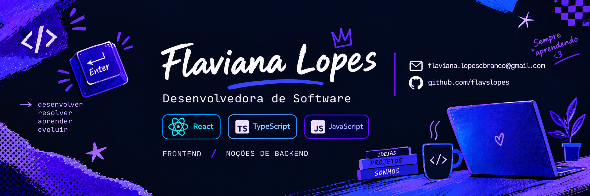

<h3>👾 Sobre mim</h3>

Sou desenvolvedora front-end em formação, com experiência em <strong>React.js, TypeScript</strong> e <strong>Next.js</strong>. Minha paixão é criar interfaces web modernas, sempre com foco em desempenho, escalabilidade e em proporcionar a melhor experiência para o usuário.

Minha trajetória inclui experiência prática como estagiária na área de desenvolvimento de software, onde tive a oportunidade de colaborar em projetos de aplicações web, utilizando versionamento de código e integração com APIs.

Além das minhas habilidades técnicas, valorizo muito minhas soft skills, como comunicação clara, adaptabilidade, trabalho em equipe e uma abordagem proativa na resolução de problemas.

Atualmente, estou cursando <strong>Análise e Desenvolvimento de Sistemas</strong> e continuo aprofundando meus conhecimentos em UI/UX, metodologias ágeis e nas melhores práticas de programação.

---

<h3>💻 Linguagens e Tecnologias</h3>

  &nbsp;
  &nbsp;
  &nbsp;
  &nbsp;
  &nbsp;
  &nbsp;
  

---

<h3>✈️ Minhas contribuições</h3>

  

---

<h3>🔗 Redes Sociais</h3>

  
  
  

